# Lab 04 - Multi-AZ Resilience with an Application Load Balancer and Auto Scaling

**Name:** William Schoen  
**Course:** Cloud Computing  
**Date:** October 17, 2026

## Objective

In this lab, I extended the uploader/viewer application from the previous lab with an Application Load Balancer (ALB), two target groups, and Auto Scaling Groups (ASGs). I then tested whether each application recovered automatically after its EC2 instance was terminated.

## Architecture

- One ALB across `us-east-2a` and `us-east-2b`
- Listener port `8080` forwards to the uploader target group
- Listener port `8081` forwards to the viewer target group
- Both applications run on port `3000`
- One ASG per application with desired capacity `1`
- EC2 application traffic is allowed only from the ALB security group
- S3 stores the shared application data

## Stack Creation and Application Access

The creation script completed and returned both ALB URLs.

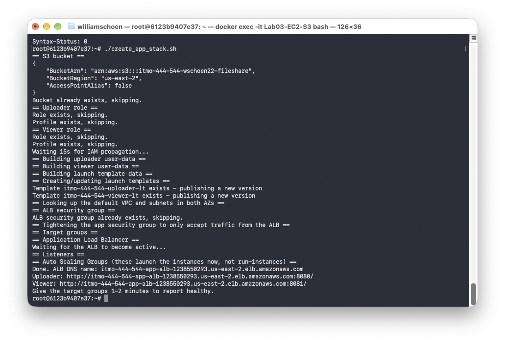

Both application routes were reachable through the ALB. The uploader interface loaded on port `8080`, and the viewer on port `8081` displayed the content previously submitted through the uploader.

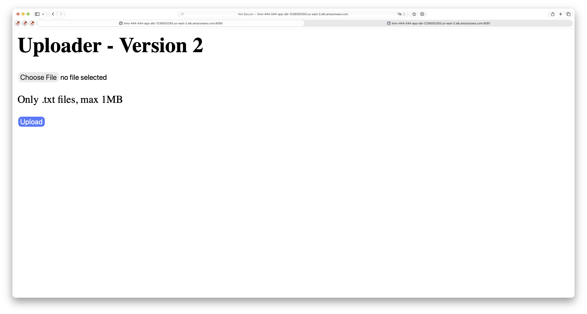

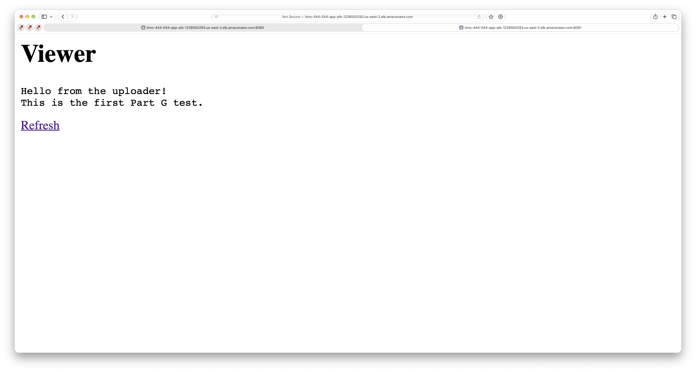

## Target Health

Both target groups reported their EC2 instances as `healthy`.

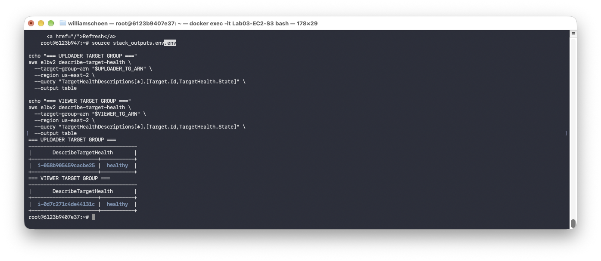

## Chaos Test: Passing SLO

The uploader recovered in **78.1 seconds**, which passed the configured **180-second SLO**.

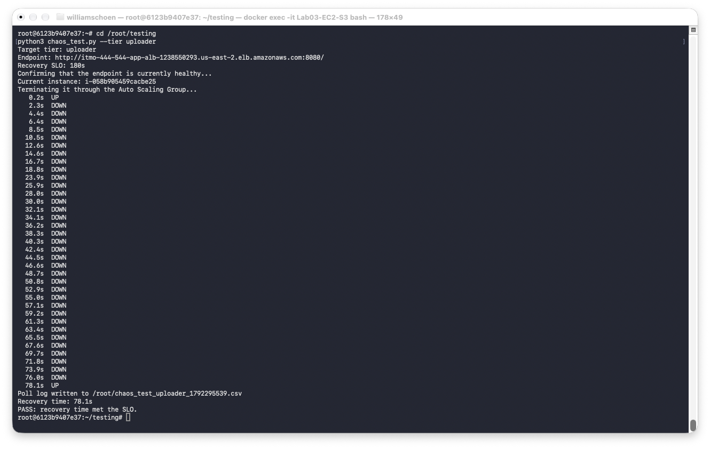

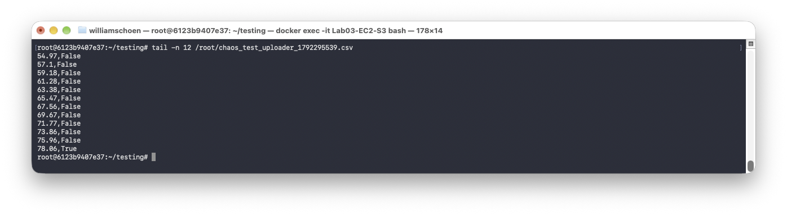

The viewer also passed the 180-second SLO and recovered in **70.4 seconds**.

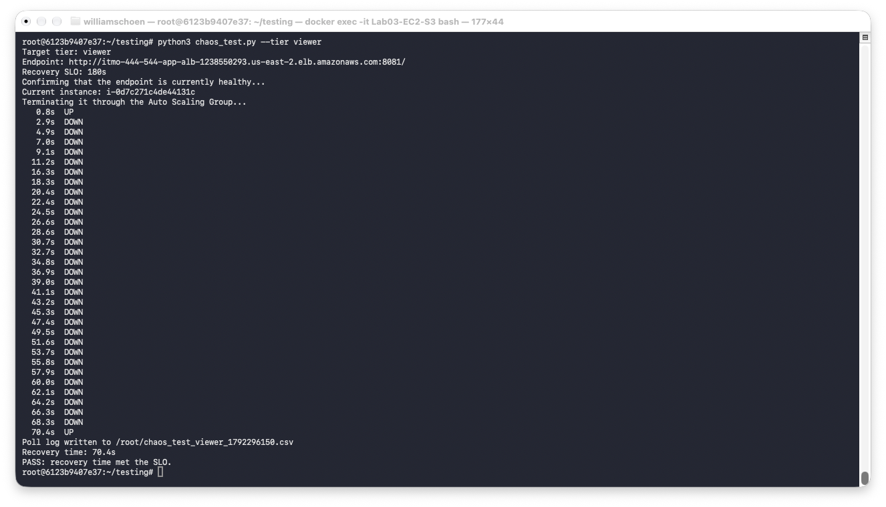

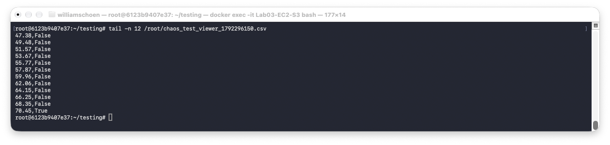

## Chaos Test: Tightened SLO Failure

With the viewer SLO reduced to **60 seconds**, recovery took **74.0 seconds**. The test correctly reported `FAIL` because recovery exceeded the tightened SLO.

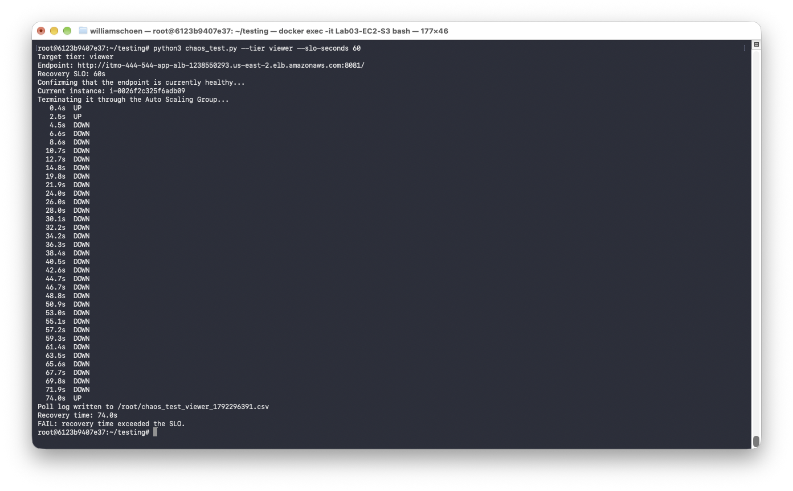

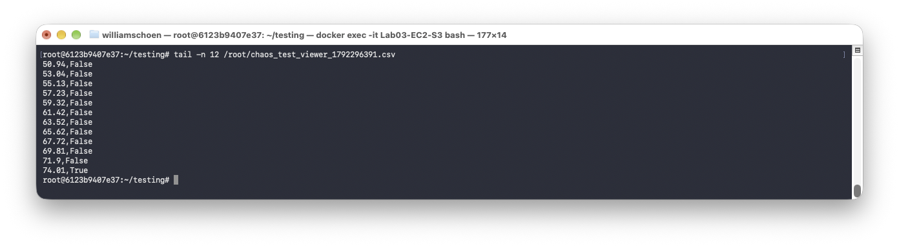

The submitted poll logs are available in [`evidence/uploader_pass.csv`](evidence/uploader_pass.csv) and [`evidence/viewer_fail.csv`](evidence/viewer_fail.csv).

## Recovery-Time Analysis

Recovery consistently took about 70–78 seconds. The ALB health checks contribute to the final delay, but the larger part is the replacement instance starting, running user data, installing Node.js dependencies with `npm install`, and starting the application. The health-check interval and threshold then add time before the new instance receives traffic.

## Changes from the Previous Lab

The old direct `aws ec2 run-instances` calls were replaced by one Auto Scaling Group for each application. Each ASG launches from its launch template, registers the instance with the correct target group, and automatically replaces a failed instance. The deletion script now removes the ASGs, ALB, listeners, target groups, and ALB security group before deleting the remaining resources.

## Possible Improvements

- Build an AMI with Node.js and dependencies already installed to reduce recovery time.
- Run more than one instance per tier to avoid downtime during replacement.
- Use HTTPS listeners and restrict public access further.

## Cleanup

The deletion script completed without errors and removed the lab resources.

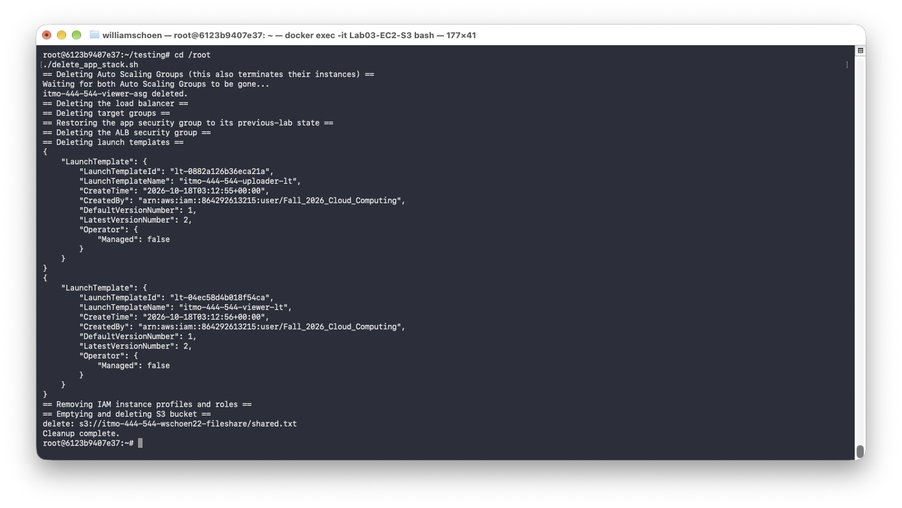

## Reflection

This lab showed that an ASG can restore capacity automatically, but a desired capacity of one still causes temporary downtime. The 180-second SLO passed, while the 60-second SLO exposed the time required to boot, configure, and pass ALB health checks.

## Submitted Files

- [`create_app_stack.sh`](create_app_stack.sh)
- [`delete_app_stack.sh`](delete_app_stack.sh)
- [`testing/chaos_test.py`](testing/chaos_test.py)
- Passing and failing CSV poll logs in [`evidence/`](evidence/)
- Screenshots in [`screenshots/`](screenshots/)
