# Lab 03 - Two-Tier File Upload & Display with EC2, S3, and IAM Roles

**Author:** William Schoen  
**Course:** Cloud Computing  
**Repository:** cloud-computing-labs  
**Report date:** October 3, 2026

## Objective and outcome

I built a small two-tier file-sharing application on AWS. One EC2 instance uploads text files to S3, while a second EC2 instance reads and displays the stored text. Bash scripts create and remove the required AWS resources. I tested valid uploads, updated content, invalid files, launch-template versioning, IAM permissions, and cleanup.

## 1. Local application structure

The local `lab03` directory contains separate `uploader-app` and `viewer-app` folders. Each has its own `app.js` and `package.json`.

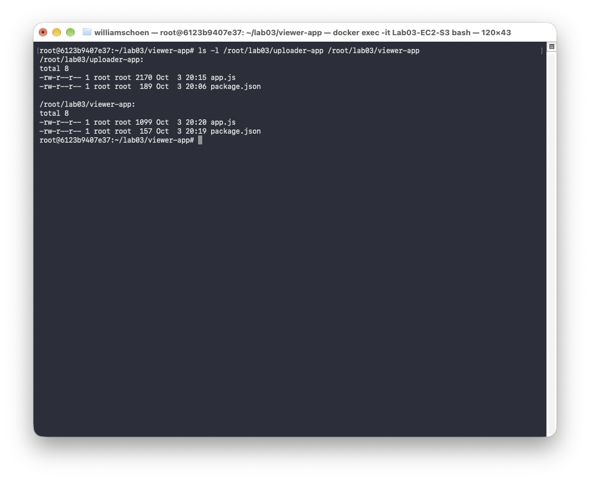

## 2. S3 storage design

Both applications use the private S3 bucket `itmo-444-544-wschoen22-fileshare` in `us-east-2`. The uploader writes to `shared.txt`, and the viewer reads that same object. Uploading another file replaces the old content, so the viewer shows the new text after a refresh.

## 3. Separate IAM roles and least-privilege permissions

The two applications use separate IAM roles because they do different jobs. The uploader role, `itmo-444-544-uploader-role`, can write `shared.txt` with `s3:PutObject`. The viewer role, `itmo-444-544-viewer-role`, can read it with `s3:GetObject`; its policy also includes `s3:ListBucket` on the bucket. This follows least privilege: the uploader does not need read access, and the viewer does not need write access. If one application were compromised, the attacker would not automatically receive both permissions.

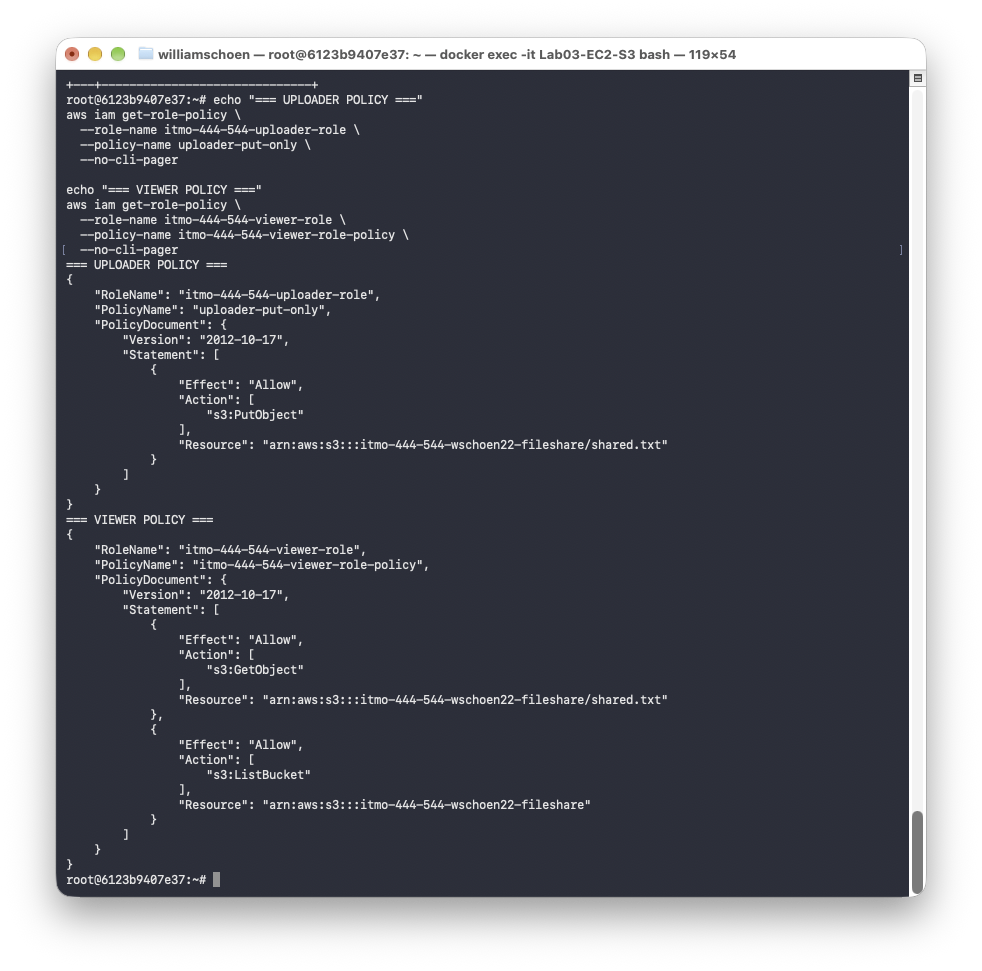

An earlier check shows the uploader permission restricted to `s3:PutObject` on the exact `shared.txt` object.

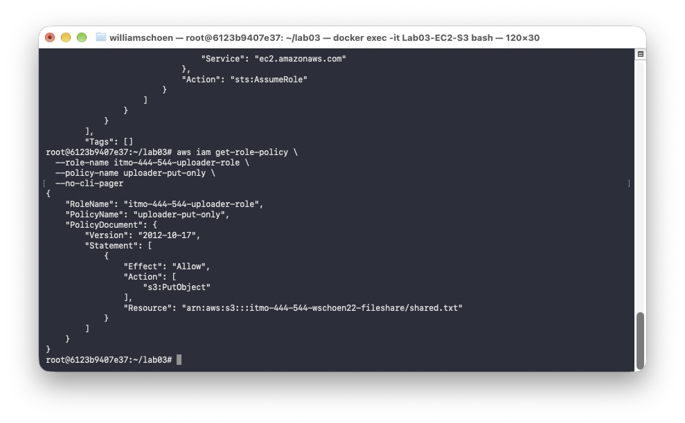

## 4. Automated stack creation

`create_app_stack.sh` reads the deployment settings from `.env`, prepares the S3 bucket and IAM resources, builds the user-data, and creates or updates both launch templates. It then launches one uploader instance and one viewer instance.

The first successful run showed both instances in the `running` state with public IP addresses.

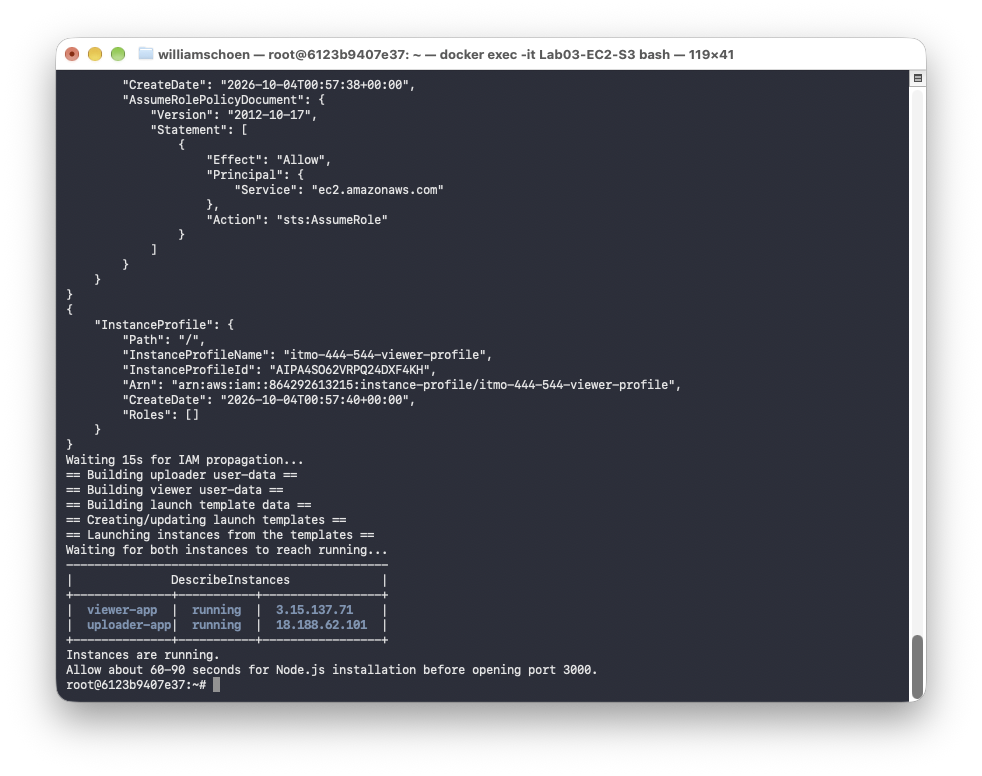

The application code is included directly in the EC2 user-data startup script. Therefore, the instance receives the code when it starts and does not need to download it from GitHub or S3.

## 5. End-to-end upload and viewer tests

A valid text file was selected on the uploader page and accepted by the application. The upload-success response confirms that the uploader wrote the object to S3.

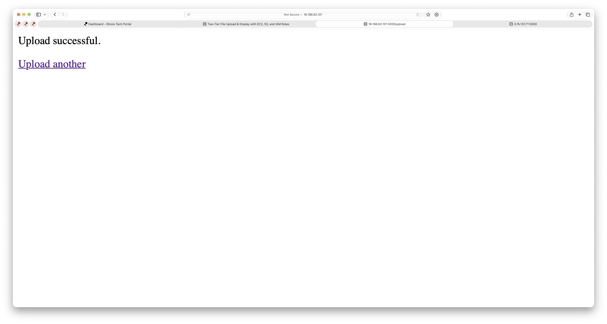

The viewer then displayed the first uploaded content:

```text
Hello from the uploader!
This is the first Part G test.
```

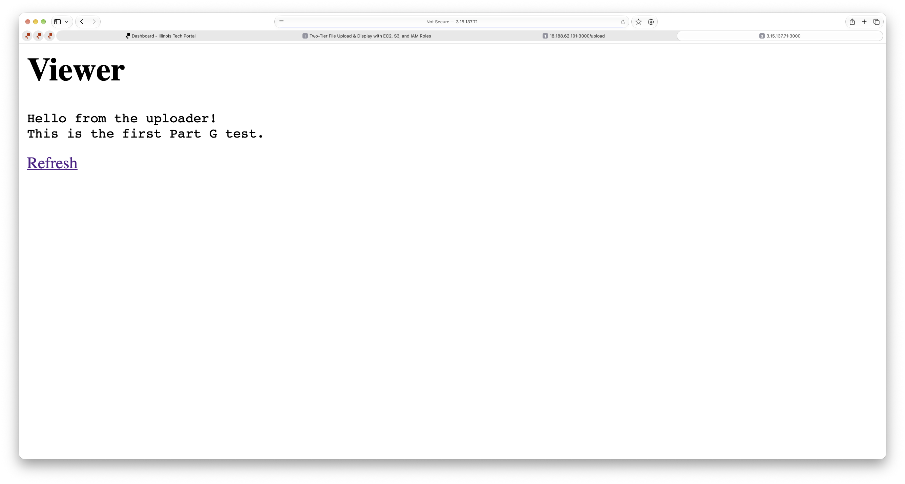

After a second, different text file was uploaded and the viewer was refreshed, it displayed the replacement content from the same S3 key:

```text
This is the updated file.
The viewer is reading live from S3.
```

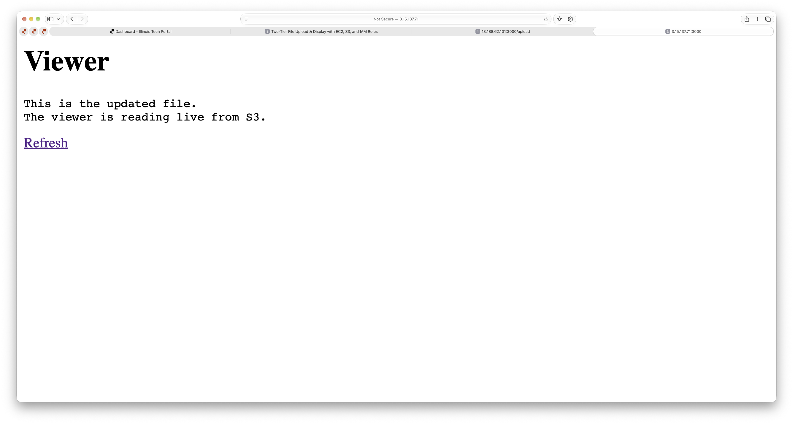

This confirms the full path: uploader EC2 instance -> S3 -> viewer EC2 instance.

## 6. Upload validation tests

### File-size validation

A `.txt` file larger than 1 MB was rejected with the expected `file exceeds the 1MB limit` message.

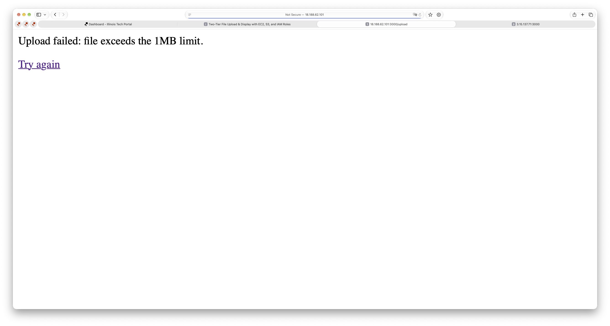

### File-type validation

A PDF was also rejected with the expected `only .txt files are allowed` response.

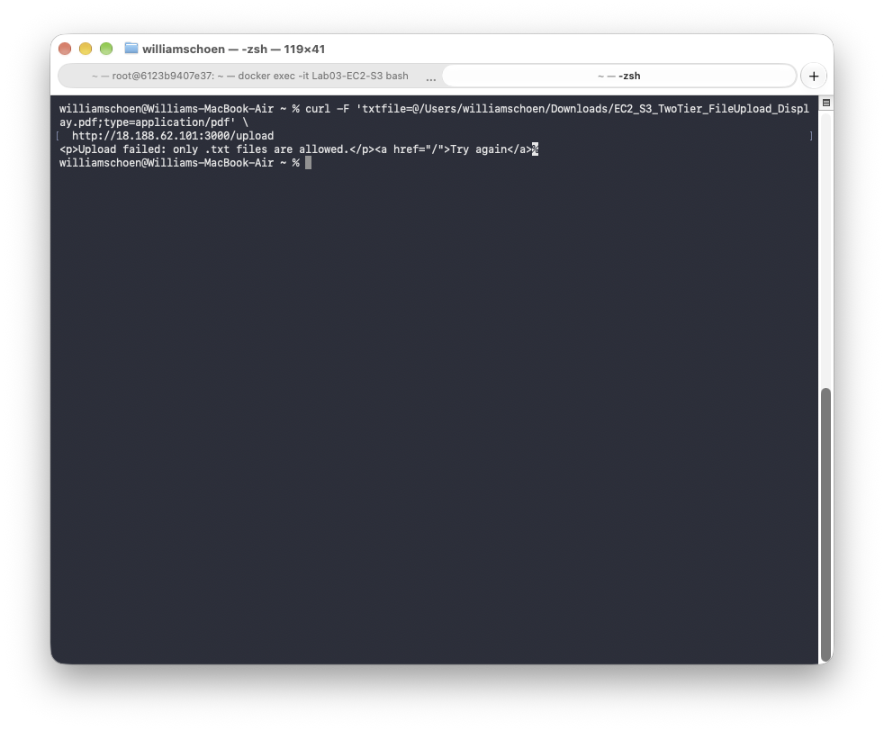

The HTML input uses `accept=".txt"`, so Safari only allowed text files in the file chooser. I therefore used `curl`, a command-line tool for sending HTTP requests, to send the PDF to the same `/upload` endpoint with the form field `txtfile`. The returned error proves that the server also checks the file type.

## 7. Launch templates and template versioning

The deployment created two launch templates: `itmo-444-544-uploader-lt` and `itmo-444-544-viewer-lt`. They contain the settings needed to launch each application with its own instance profile and user-data.

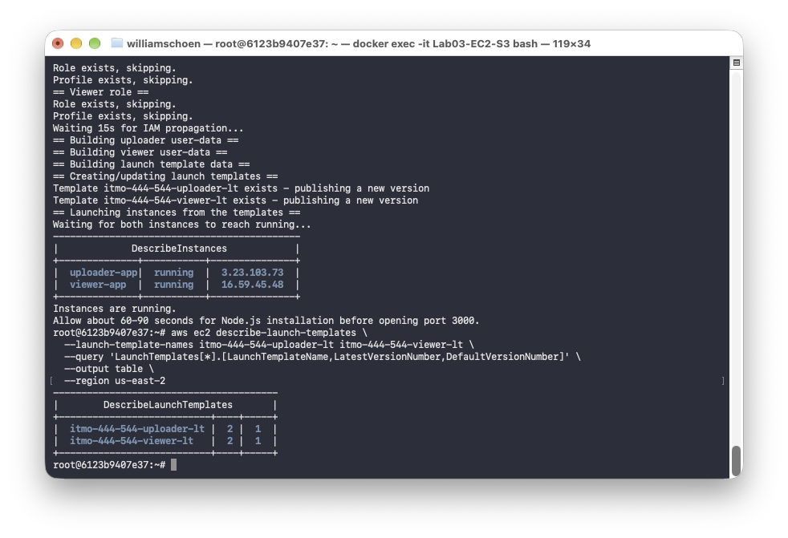

After running the create script again, both templates contained versions 1 and 2 instead of overwriting version 1.

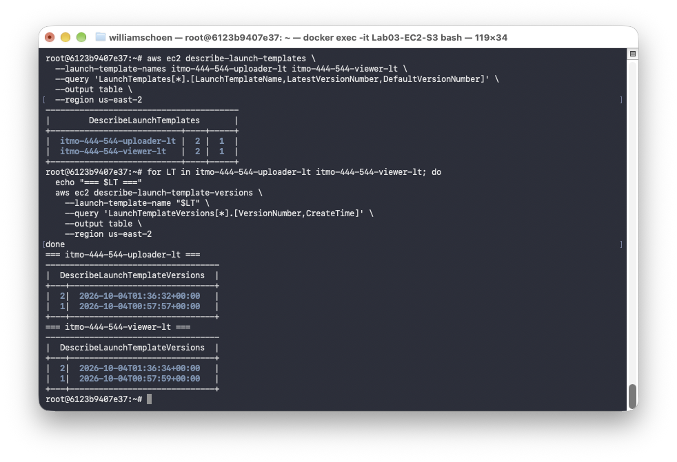

## 8. Deployment of Uploader Version 2

I changed the heading from `Uploader` to `Uploader - Version 2`. I terminated the original instances and ran `create_app_stack.sh` again. The script published new template versions and launched replacement instances from them.

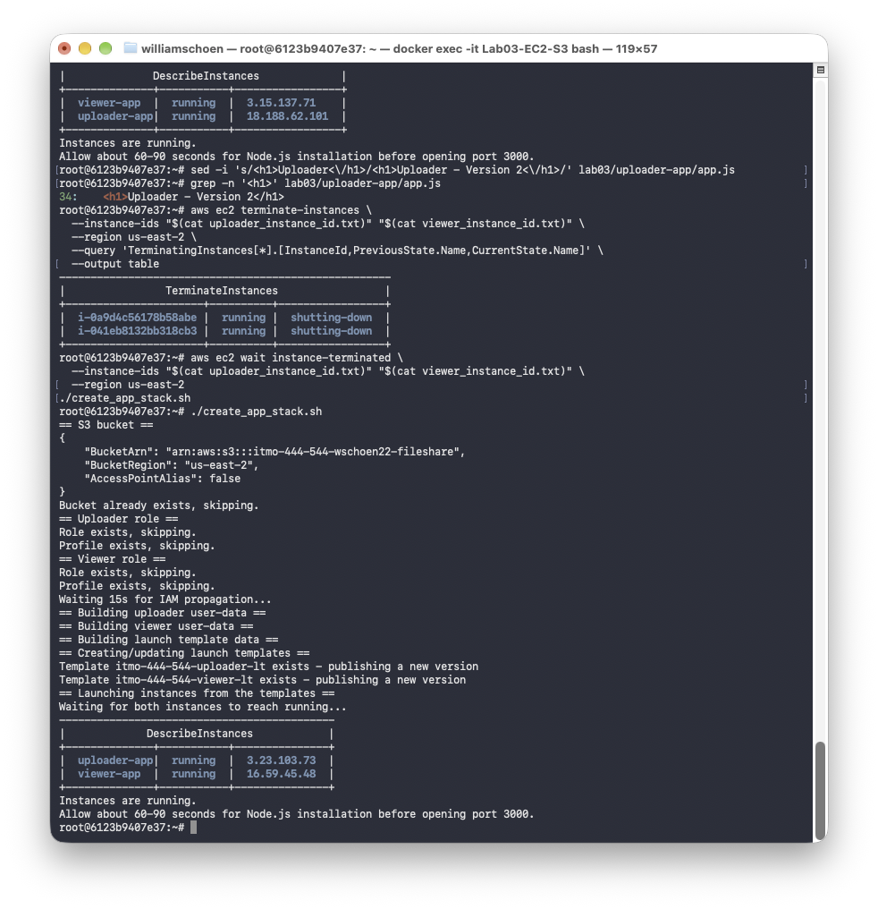

The replacement uploader displayed the changed heading, confirming that the new instance received the edited code.

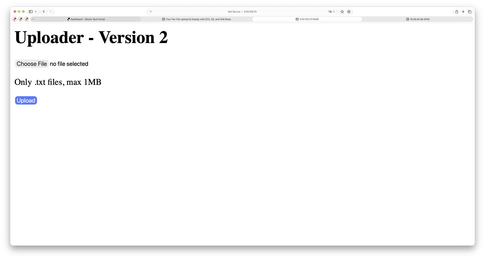

## 9. Automated cleanup and final verification

`delete_app_stack.sh` terminated both instances, deleted the launch templates, removed the IAM roles and profiles, emptied the S3 bucket, and deleted it. The script finished with `Cleanup complete.` and no error.

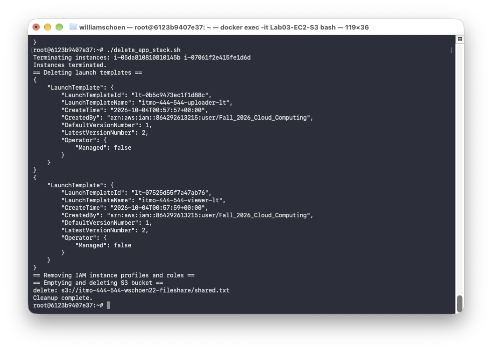

A final filtered `describe-instances` command returned no rows. This confirmed that no active or stopped Lab 03 application instances remained.

## Reflection

The most useful part of this lab was seeing how two separate EC2 applications can share data through S3 without sharing the same permissions. Launch-template versioning also made the update easy to verify: after changing one heading and redeploying, the replacement instance showed the new version. Finally, the cleanup script made it much safer to finish the lab without leaving running resources behind.
