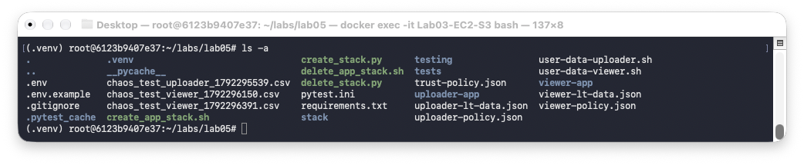
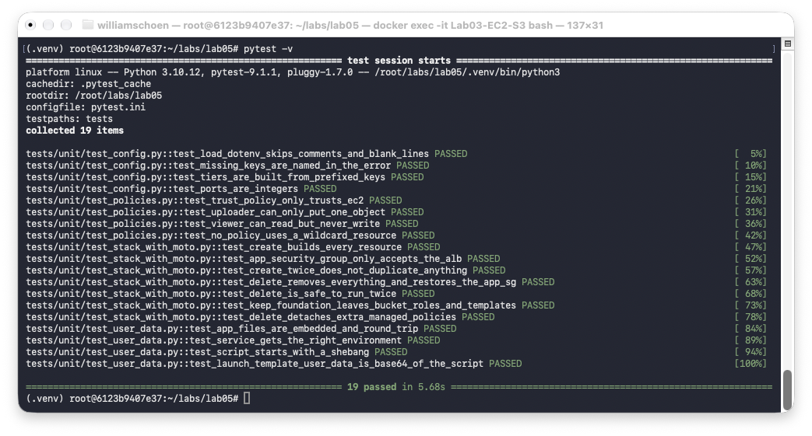
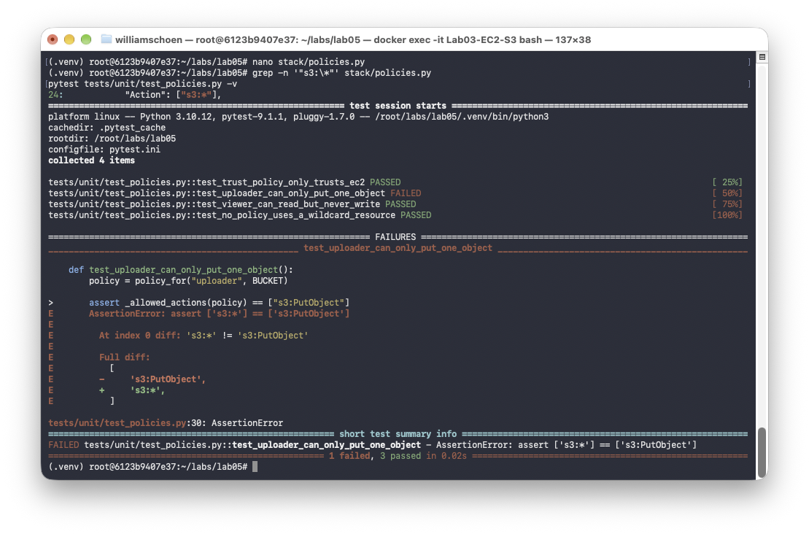
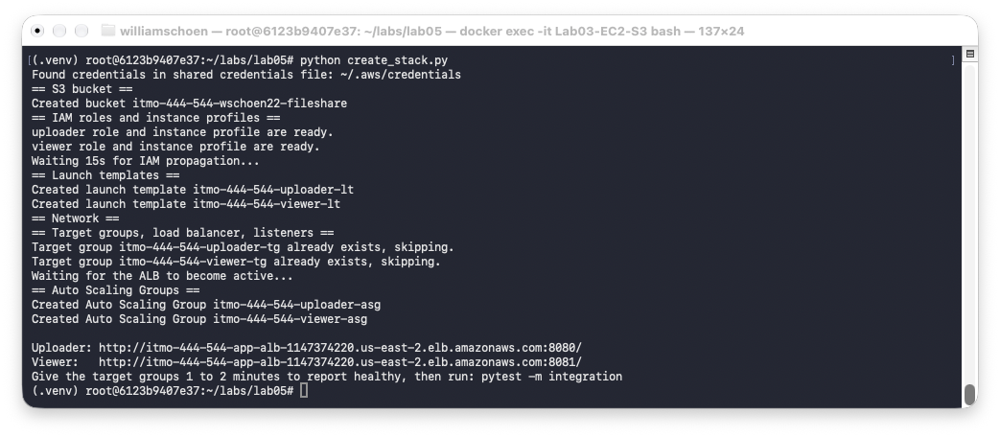
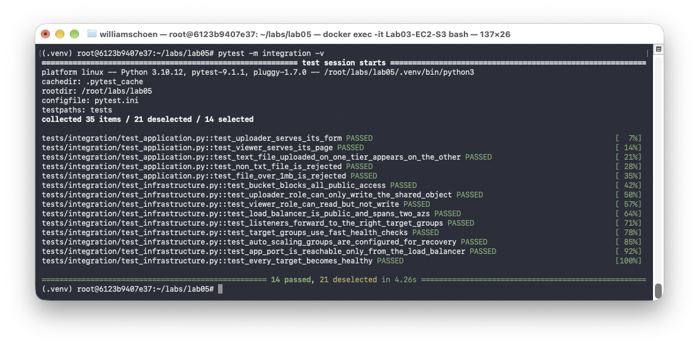
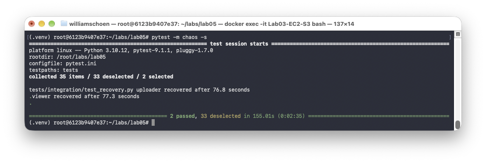
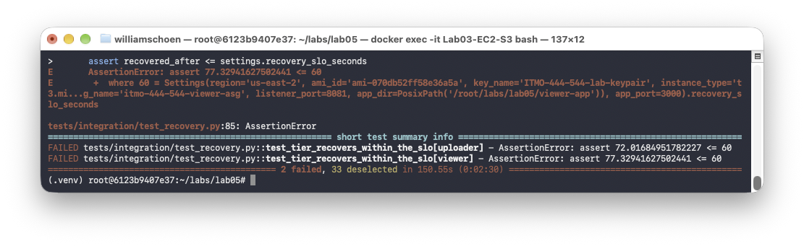
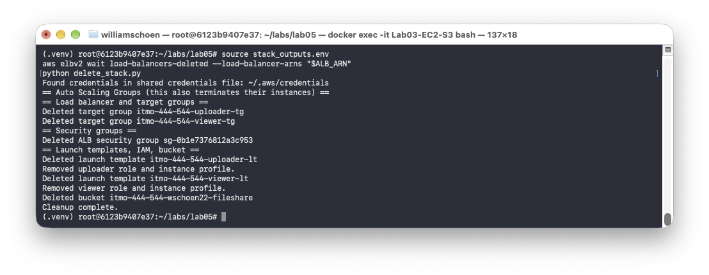
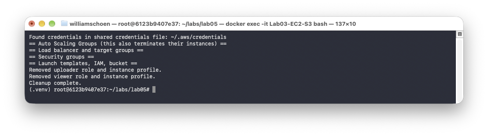
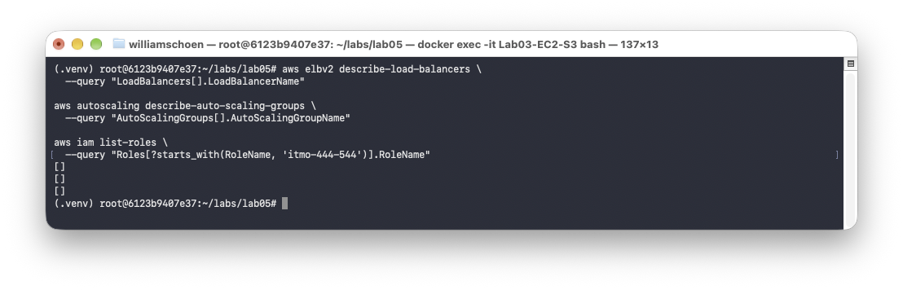

# Lab 05 - Infrastructure as Python with boto3 and pytest

**Author:** William Schoen  
**Course:** Cloud Computing  
**Repository:** cloud-computing-labs  
**Report date:** October 24, 2026

## Objective

I replaced the Bash and AWS CLI workflow from Lab 04 with Python and `boto3`. I tested the code with unit, integration, and chaos tests.

## 1. Project structure

The project has separate folders for the stack code, tests, uploader, and viewer.

## 2. Unit tests with moto

All **19 unit tests passed** with Python 3.10.12. `moto` tested the stack code without creating real AWS resources.

### Break-it-on-purpose experiment

I changed the uploader permission from `s3:PutObject` to `s3:*`. The correct test failed. After restoring the policy, all 19 tests passed again.

## 3. Stack creation

`python create_stack.py` created the AWS stack and returned both ALB URLs.

## 4. Integration tests

All **14 integration tests passed**. They checked the real infrastructure, IAM permissions, network security, target health, and both applications.

## 5. Chaos test

With a **180-second SLO**, the uploader recovered in **76.8 seconds** and the viewer in **77.3 seconds**. Both tests passed.

## 6. Tightened SLO

I reduced the SLO to **60 seconds**. The uploader took about **72.0 seconds** and the viewer about **77.3 seconds**, so both tests failed as expected. I then changed the SLO back to **180 seconds**.

## 7. What moto proved

Moto showed that my code made the expected API calls in a simulated AWS environment. It could not prove that real EC2 instances start, the apps answer over HTTP, or failed instances are replaced in time. The integration and chaos tests checked these parts on real AWS.

## 8. Targeted error handling

The Bash command `2>/dev/null || true` hides every error, including permission problems, typing mistakes, and unexpected AWS failures. In Python, `ignore_errors("EntityAlreadyExists")` ignores only the known error that means a resource already exists. Every other error is still shown and stops the script. This makes failures easier to understand and prevents the script from continuing after a serious problem.

## 9. Cleanup

`python delete_stack.py` removed the Lab resources. The code waits until the ALB is deleted before it removes the target groups.

The second run also finished without an error. This showed that cleanup is safe to repeat.

## 10. Final AWS check

The final required checks found no load balancers, Auto Scaling Groups, or matching Lab IAM roles.

## 11. Challenge 5 - Reflection

Deleting an IAM role was shorter in Bash because errors could be hidden with `2>/dev/null || true`. The Python version needs more lines because it checks whether the role and instance profile exist, removes the role from the profile, and detaches managed policies before deletion. These extra steps give clearer errors, make repeated cleanup safe, and allow the behavior to be tested with `moto`.

## Final reflection

Python needs more structure than Bash, but it is easier to test and maintain. `moto` gave fast local tests, while the integration and chaos tests checked the real AWS system.

## Submitted files

- Python stack code
- Unit and integration tests
- Uploader and viewer applications
- `requirements.txt`, `pytest.ini`, and `.gitignore`
- Screenshots of the results
