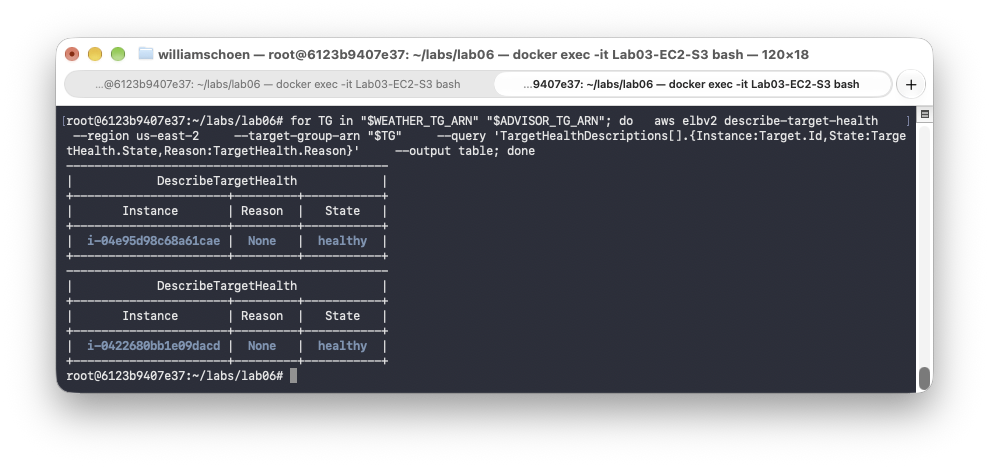
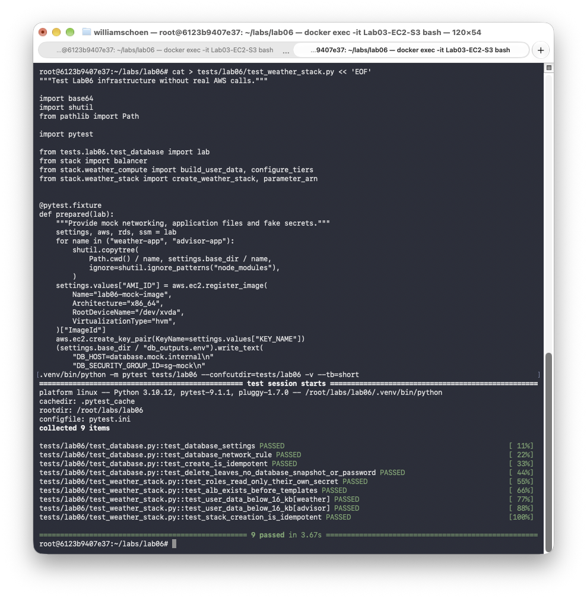
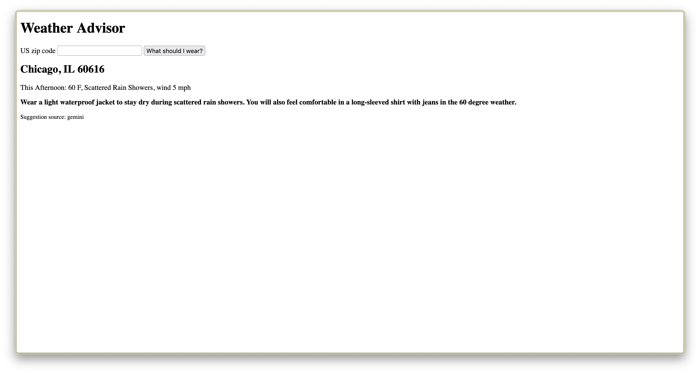

# Lab 06 - Weather Advisor in AWS

**Author:** William Schoen  
**Course:** Cloud Computing  
**Repository:** cloud-computing-labs  
**Report date:** October 31, 2026

## Objective

I built a Weather Advisor with two Node.js applications and a PostgreSQL database. I used Python and boto3 to create and delete the AWS resources. I reused the infrastructure modules from Lab 05 and added tests for the new application.

## 1. Architecture and deployment

The application runs in Ohio, in AWS region us-east-2. One Application Load Balancer routes requests to the Weather and Advisor services. Each service has its own Auto Scaling Group with one desired instance.

Weather converts a US ZIP code into coordinates with Zippopotam.us. It then calls the National Weather Service to get a forecast. It stores cached forecasts and lookup history in a private PostgreSQL database on Amazon RDS. Advisor calls Weather and asks Gemini for a clothing suggestion. If Gemini fails, Advisor can return a clearly labelled fallback.

The ALB listens on port 8080 for Weather and port 8081 for Advisor. Both applications use port 3000. Their security group allows requests from the ALB security group. PostgreSQL accepts connections on port 5432 from the application security group.

Both targets became healthy after the initial installation finished.



Deployment logs: [Database](evidence/database-create.txt) and [application stack](evidence/stack-create.txt).

## 2. Offline tests with Moto

All **9 infrastructure tests passed**. They checked the database settings, the database network rule, IAM policy isolation, the ALB-first creation order, user-data size and repeated creation. The database deletion test also checked repeated deletion and the removal of the database, snapshots and password parameter.



I also ran the tests with the real AWS credential files disabled. They passed again. [Full offline test results](evidence/offline-tests.txt).

## 3. Weather, cache and history

The first request for ZIP **60616** returned the Chicago forecast with `cache: miss`. The second request returned `cache: hit`. The history endpoint showed the stored Chicago lookup.

Results: [First request](evidence/weather-first.json), [second request](evidence/weather-second.json) and [lookup history](evidence/weather-history.json).

An invalid ZIP returned **HTTP 400**. An unknown ZIP returned **HTTP 404**. [Invalid ZIP result](evidence/weather-invalid.txt) and [unknown ZIP result](evidence/weather-unknown.txt).

## 4. Advisor and application tests

The browser showed the Chicago forecast and a clothing suggestion from Gemini. The JSON response also included `source: gemini` and the model name.



[Advisor JSON response](evidence/advisor.json).

All **5 application tests passed**. They checked the forecast, cache, history, invalid and unknown ZIP codes, advice and the HTML page. The automated test accepts a cache hit on its first request because data may already exist. The separate initial request files show the actual change from miss to hit.

[Full application test results](evidence/application-tests.txt).

## 5. IAM and network checks

The IAM simulator allowed Weather to read its database password parameter and denied access to the Gemini parameter. Advisor could read the Gemini parameter and was denied access to the database password parameter. [IAM simulator results](evidence/iam-isolation.txt).

From my local Docker container, I could not connect directly to either application on port 3000 or to PostgreSQL on port 5432. Requests through the ALB worked. A failed connection alone does not prove which network rule blocked it.

[Network results in English](evidence/network-isolation-en.txt), translated from the [original German output](evidence/network-isolation.txt).

The IAM simulator and network checks were run separately. They are not yet included as pytest integration tests.

## 6. Database connection failure

The test removed the database ingress rule and restarted Weather. Weather still returned **HTTP 200** with a forecast and `cache: unavailable`. The test then restored the rule and restarted Weather. The next response returned **HTTP 200** with `cache: hit`.

The test passed in **12.42 seconds**. [Database outage test log](evidence/database-outage.txt).

## 7. Instance failure and recovery

The test terminated the Weather instance. Advisor returned **HTTP 502** during the outage. It returned **HTTP 200 after 191.1 seconds**. The test confirmed a different healthy Weather instance after **206.9 seconds**, within the 300-second limit.

This test measured the Advisor response and the health of the replacement Weather target. It did not separately record a Weather HTTP response at the recovery time.

[Full instance recovery test log](evidence/instance-recovery.txt).

## 8. What Moto could not prove

Moto helped me check the AWS requests and simulated resource state without creating real resources. I could test database settings, security group rules, IAM policy scope and repeated creation. These tests were fast and did not need real AWS credentials.

Moto does not start EC2 instances or run cloud-init. It does not install Node.js packages or start a real PostgreSQL server. Its simulated load balancer does not send requests to running applications. A passing Moto test therefore cannot prove that the applications start correctly or that the database queries work.

The live application tests covered these gaps by requesting real forecasts, reading the cache and checking stored history. The database outage test checked that Weather still answered when the database connection failed. The instance recovery test checked that Auto Scaling replaced a terminated instance and that Advisor recovered in time.

Moto also cannot prove real network isolation. The connection probes checked reachability from my local Docker environment. The IAM simulator checked the configured access decisions for both roles. These checks were saved separately and still need to be added to the automated integration suite.

Weather uses the RDS certificate bundle to verify the database certificate. The cache and history requests worked with this setting. I did not test an invalid certificate, so I cannot use these results to show that an invalid certificate would be rejected.

Real backup storage also needed an AWS check. The code sets backup retention to zero and requests deletion without a final snapshot or retained automated backups. Moto only checked simulated state. The final AWS check found no matching database instances, snapshots or retained automated backups. [Cleanup verification](evidence/cleanup-verification.txt).

## 9. Python compared with Bash

Creating the database was easier to test in Python because boto3 returns structured data. I could build the request in a function and check its settings with Moto. Specific ClientError codes also made it easier to distinguish a missing database from a permission error. Bash was convenient for short commands and saving output, but parsing CLI output and managing error handling would need more care. Python needed more setup, but pytest made repeated creation and deletion easier to check.

## 10. Setup and test commands

Run the commands from the lab06 directory with Python 3.10 or newer:

```bash
python3 -m venv .venv
.venv/bin/python -m pip install -r requirements.txt
cp .env.example .env
```

Adjust `.env` for the AWS account. Check the AMI, key pair, application security group, region, availability zones and contact email. Configure AWS credentials separately.

```bash
.venv/bin/python store_gemini_key.py
.venv/bin/python create_database.py
.venv/bin/python create_weather_stack.py
```

The Gemini key is entered with a hidden prompt. The database password is randomly generated and stored in SSM. The application roles read their own parameter at runtime.

Run the offline tests without real AWS credentials:

```bash
env -u AWS_ACCESS_KEY_ID -u AWS_SECRET_ACCESS_KEY -u AWS_SESSION_TOKEN \
  AWS_SHARED_CREDENTIALS_FILE=/dev/null AWS_CONFIG_FILE=/dev/null \
  AWS_EC2_METADATA_DISABLED=true \
  .venv/bin/python -m pytest -m "not integration and not chaos"
```

Run the application tests against a working deployment:

```bash
RUN_INTEGRATION=1 .venv/bin/python -m pytest \
  tests/lab06/test_application.py -m integration
```

The following tests temporarily interrupt the deployment:

```bash
RUN_CHAOS=1 .venv/bin/python -u -m pytest \
  tests/lab06/test_database_outage.py -m chaos -s
RUN_CHAOS=1 .venv/bin/python -u -m pytest \
  tests/lab06/test_instance_recovery.py -m chaos -s
```

The database outage test needs SSH access and the private key at `/<KEY_NAME>.pem`. Before running the offline tests in a fresh copy, create `.env` from `.env.example` as shown above.

## 11. Cleanup

I removed the application stack and the database with the Python deletion scripts:

```bash
.venv/bin/python delete_weather_stack.py
.venv/bin/python delete_database.py
```

The first two attempts reached the 300-second wait limit while AWS was deleting the Auto Scaling Groups. Once both groups were gone, I ran the script again. It removed the load balancer, target groups, launch templates, instance profiles and roles. The database script then removed PostgreSQL, its subnet group, security group and password parameter. I removed the Gemini parameter with boto3 as the final step.

The final check found **zero remaining resources in all 12 checked categories**, including database snapshots and retained automated backups. The existing EC2 key pair and shared application security group were kept for the other labs. The check did not separately list EC2 instances or EBS volumes.

Results: [Stack deletion](evidence/stack-delete.txt), [database deletion](evidence/database-delete.txt) and [final AWS verification](evidence/cleanup-verification.txt).

## Submitted files

- Python scripts to [create](create_database.py) and [delete](delete_database.py) the database
- Python scripts to [create](create_weather_stack.py) and [delete](delete_weather_stack.py) the application stack, with reusable [infrastructure modules](stack/)
- [Weather application](weather-app/) and [Advisor application](advisor-app/)
- [Moto tests](tests/README.md#moto-tests), [application tests](tests/README.md#application-tests) and [chaos tests](tests/README.md#chaos-tests)
- [Example configuration](.env.example), [Python dependencies](requirements.txt) and [pytest configuration](pytest.ini)
- [Test logs and API responses](evidence/) and [screenshots](screenshots/)
